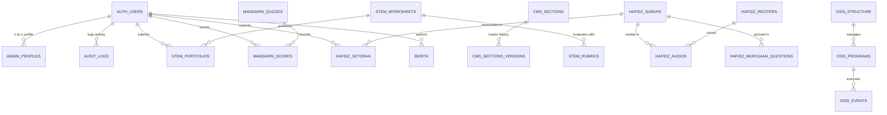

# Dokumentasi Skema Database Supabase PP Jauharul Maknuun

Dokumentasi arsitektur database resmi untuk Sistem Informasi Terpadu Pondok Pesantren Jauharul Maknuun (PPJM) Lasem Sidayu Gresik.

- **DBMS**: PostgreSQL 17 (Supabase Managed Engine)
- **Region**: `ap-south-1` (Mumbai)
- **Project Ref**: `gzijnybcmhectajfkdtd`
- **Total Tabel Wajib**: 34 Tabel
- **Storage Buckets**: 9 Buckets Terenkripsi
- **Security**: Row Level Security (RLS) On Semua Tabel + RBAC 4 Tingkat

---

## 1. Entity Relationship Diagram (ERD)

---

## 2. Struktur 34 Tabel Database

### A. CMS & Navigasi Beranda (Tabel 1 - 4)
1. **`cms_sections`**: Data JSON canvas WebVisualEditor (`hero`, `ticker`, `navbar`, `quickmenu`, `sambutan`, `keunggulan`, `program`, `fasilitas`, `news`, `cta`, `footer`).
2. **`sliders`**: 5 Flyer Hero Slider 3D Coverflow interaktif beserta link CTA dan badge.
3. **`quick_menus`**: 8 Tombol QuickMenu navigasi cepat mobile & desktop.
4. **`profiles_jm_center`**: Konten profil lembaga (`sambutan`, `sejarah`, `visi_misi`).

### B. Lembaga & Program (Tabel 5 - 9)
5. **`facilities`**: Fasilitas terstandar pesantren dengan filter kategori asrama, ibadah, sains.
6. **`institutions`**: Entitas lembaga (Pondok Salaf, SMP Plus, Madrasah Diniyah).
7. **`programs_pondok`**: Amaliyah harian kepesantrenan dan tradisi salaf.
8. **`programs_sekolah`**: Kurikulum dan rekam visual SMP Plus Jauharul Maknuun.
9. **`madin_flyers`**: Flyer dan silabus kajian kitab kuning turats santri.

### C. SMART JM: Lab Riset STEM (Tabel 10 - 12)
10. **`stem_worksheets`**: Lembar kerja praktikum mikrokontroler IoT ESP32 & nanofiltrasi air.
11. **`stem_rubrics`**: Rubrik 4 parameter penilaian (Inovasi, Metodologi, Hasil Uji, Presentasi).
12. **`stem_portfolios`**: Rekam jejak karya inovasi teknologi santri bersertifikasi.

### D. SMART JM: Mandarin Class (Tabel 13 - 15)
13. **`mandarin_vocabularies`**: Bank kosakata Putonghua HSK (Hanzi, Pinyin, audio narasi).
14. **`mandarin_quizzes`**: Kuis gamifikasi bertimer dengan skor kelulusan dan confetti.
15. **`mandarin_scores`**: Log evaluasi nilai santri dan waktu penyelesaian kuis.

### E. SMART JM: Hafidz Qur'an Digital (Tabel 16 - 20)
16. **`hafidz_surahs`**: 114 Surat Al-Qur'an mushaf Utsmani standar Kemenag RI.
17. **`hafidz_reciters`**: 15 Qari & Murottal internasional (Misyari, Sudais, Ghamidi, dll).
18. **`hafidz_audios`**: URL CDN audio ayat per ayat dengan fallback redundan.
19. **`hafidz_setoran`**: Catatan evaluasi kelancaran, tajwid, dan makhorijul huruf.
20. **`hafidz_murojaah_questions`**: Bank soal Cloze Test (tebak sambung ayat AI).

### F. Konten Publik Pesantren (Tabel 21 - 28)
21. **`berita`**: Warta resmi pesantren dan siaran pers terintegrasi broadcast WhatsApp.
22. **`galeri_foto`**: Arsip visual resolusi tinggi dengan kompresi otomatis WebP.
23. **`galeri_videos`**: Kurasi video sinematik dan dokumentasi YouTube resmi PPJM.
24. **`prestasi`**: Data kejuaraan sains robotik, tahfidz, dan pidato santri tingkat nasional.
25. **`ekskul`**: Profil ekstrakurikuler sains, bahasa, bela diri, dan seni hadrah.
26. **`osis_structure`**: Struktur Kabinet OSIS santri 3 tingkatan kepemimpinan.
27. **`osis_programs`**: Rencana kerja strategis 5 departemen kesiswaan.
28. **`osis_events`**: Agenda kegiatan dan gebyar kreasi santri terjadwal.

### G. Sistem & Tata Kelola Keamanan (Tabel 29 - 34)
29. **`agendas`**: Kalender akademik, amaliyah, dan rutinitas bulanan santri.
30. **`spmb_info`**: Informasi penerimaan santri baru, alur seleksi, dan biaya terpadu.
31. **`admin_profiles`**: Profil RBAC 4 peran (`super_admin`, `pengurus_konten`, `guru_akademik`, `santri`).
32. **`audit_logs`**: Log forensik perubahan data (siapa, waktu, IP, modul, data lama/baru).
33. **`cms_sections_versions`**: Riwayat revisi visual editor untuk pemulihan instan (undo).
34. **`kontak_medsos`**: Pengaturan 7 saluran resmi komunikasi (WA Admin, Saluran, IG, TikTok, YT, FB, Email).

---

## 3. Storage Buckets (9 Buckets)

| Bucket ID | Kapasitas Maksimal | Format MIME yang Diizinkan | Kegunaan |
| :--- | :--- | :--- | :--- |
| `avatars` | 2 MB | `image/jpeg, image/png, image/webp` | Foto profil santri & asatidz |
| `cms-images` | 5 MB | `image/jpeg, image/png, image/webp` | Aset banner WebVisualEditor |
| `berita-images` | 5 MB | `image/jpeg, image/png, image/webp` | Gambar warta & liputan |
| `galeri-foto` | 10 MB | `image/jpeg, image/png, image/webp` | Dokumentasi kegiatan pondok |
| `prestasi-certificates` | 5 MB | `application/pdf, image/jpeg, image/png, image/webp` | Sertifikat piagam kejuaraan |
| `stem-portfolios` | 10 MB | `application/pdf, image/jpeg, image/png, image/webp` | Bukti fisik hasil riset IoT |
| `mandarin-audios` | 10 MB | `audio/mpeg, audio/mp3, audio/wav` | Pelafalan nada HSK Mandarin |
| `hafidz-audios` | 20 MB | `audio/mpeg, audio/mp3, audio/wav, audio/m4a` | Rekaman murottal & setoran santri |
| `madin-flyers` | 10 MB | `application/pdf, image/jpeg, image/png, image/webp` | Flyer kitab turats salafiyah |

